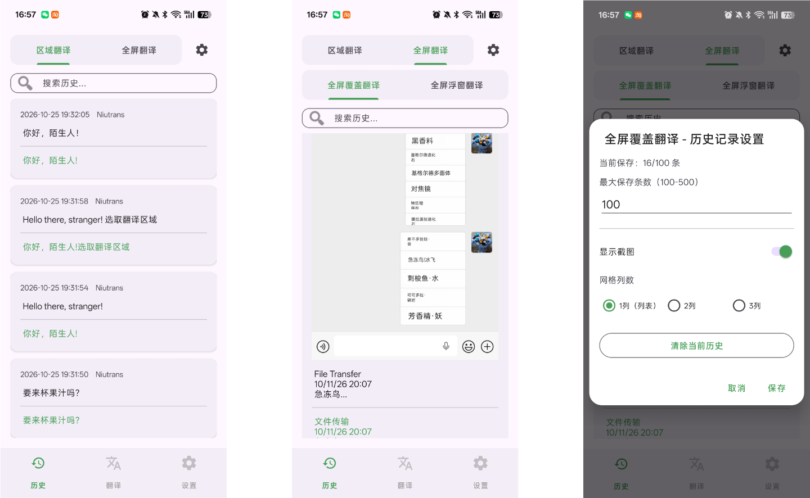

# 龙译-Dralingo

专为安卓手机和游戏掌机玩家开发的翻译软件，由萌译MoeTranslator基础上，二次开发而来，特此感谢萌译大佬开源。

完全免费，无广告，为爱发电！ 如果深得你心，请我喝杯咖啡吧。[～咖啡～咖啡](https://raw.githubusercontent.com/canababa/Dralingo/refs/heads/main/pay.png)

## 使用介绍请查看B站：https://b23.tv/na1HQ9x

## 制作历程

作为一个游戏玩家，近段时间沉迷开源怀旧掌机。儿时印象最深的就是宝可梦系列，初次在小学同学家见到Gameboy的宝可梦-黄，就被深恨吸引。后续初中有了GBA, 跟同学线下对战红蓝宝石，交换宝可梦，玩的天昏地暗。现在怀旧掌机中已经有了很多GBA宝可梦游戏的外网改版，因为是英文的，所以需要一款翻译软件。一开始在B站上找到了萌译，但有无法满足我的需求。然后我又购买了安卓端的游戏翻译助手，整体功能已经比较完善，但还是满足不了我的需求。所以我在萌译大佬开源的代码中，根据自己的使用习惯做了二次开发，精简了功能模块，增加了大量实用功能，目前基本上实现了我所需的所有功能。从 26 年 10 月 1 日开始开发，到目前 3.6.2 版本的完成，经历了 26 天时间，功能好实现，就是bug改的快吐血了，总之希望大家喜欢，玩的愉快。

tips:如果有人问我为什么不做汉化，我想说我真的在认真学英语。

## 简介 

龙译是一款安卓端的翻译软件，基于无障碍截图权限开发。所以只适合安卓的掌机使用，Linux掌机不能使用。

正好掌机按键映射也需要无障碍权限，所以没用市面上主流的MediaProjection方案，更加省电和减少cpu性能开销。

-特色功能：

1.双选区翻译，第二选区可自定义，可同时自动翻译

2.术语库匹配（自定义属性后缀、双语双向匹配）

3.自动翻译（帧差检测、文本缓存匹配、智能省电）

4.全屏智能覆盖翻译（智能采样、多行合并）

5.手柄按键映射，自定义手柄按键绑定特定功能

6.历史记录功能（可点击复制原文和译文，全屏覆盖翻译也做了相同功能，还可分列显示）

## 一、翻译功能

翻译是龙译的核心功能，支持不同的API（包括AI接口或常见的机器翻译接口），每个API的申请方法可去萌译官网中查看[详细的教程](https://www.moetranslate.top/docs/translation/apiconfig/)。

除此之外，您还可以**自定义API接口**来进行翻译，上述两种模式均支持自定义API接口，也就是说，**您可以在局域网内的电脑上搭建您喜欢的翻译服务（如：搭建Sakura本地翻译模型），然后通过萌译在手机上享受这些服务带来的便利**。这种方法需要您掌握一定的编程知识和计算机网络知识，在萌译官网上有一些简易的[搭建教程](https://www.moetranslate.top/docs/translationapi/customtext/)。

### 1、使用方法

简易的使用方法：

1.先开启无障碍权限、通知权限、悬浮窗权限

2.选择API接口

3.选择翻译模式：区域翻译、全屏翻译

4.点击开始翻译后，点击悬浮球翻译

5.可在个性化设置页面中自定义设置

### 2、预置API介绍

## 二、其他功能

### 1、术语库匹配功能

-1.可开启或关闭属性显示，在导入术语时以English=中文·属性   ·*！符号可以表示属性。针对于宝可梦游戏特别做的功能

-2.可开启或关闭双向匹配

### 2、手柄按键映射

-可录制手柄按键，自定义翻译功能

### 3、历史记录功能

## 捐助项目

如果您想给开发者物质上的帮助，那就请我喝杯咖啡吧。

## 使用到的其他开源项目

- [RTranslator](https://github.com/niedev/RTranslator)  
  本地运行的适用于 Android 的开源实时翻译应用程序。萌译中的NLLB翻译功能使用了 RTranslator 项目的模型和代码。

- [PaddleOCR](https://github.com/PaddlePaddle/PaddleOCR)  
  全球领先的 OCR 工具包与文档 AI 引擎。萌译中的OCR步骤使用了 PaddlePaddle/PP-OCRv6_small_rec_onnx 的模型。

- [Live 2D SDK](https://www.live2d.com/)  
  用于展示和操作 Live2D 模型的框架。萌译的 Live 2D 功能使用到了 Live 2D SDK。

- [ColorPicker](https://github.com/jaredrummler/ColorPicker)  
  Android 的颜色选择器组件。

- [Konfetti](https://github.com/DanielMartinus/Konfetti)  
  Android 的粒子效果库，用于创建炫酷的视觉效果。

更多使用到的基础开源项目请在萌译中的【设置】->【关于】->【开放源代码声明】中查看。
